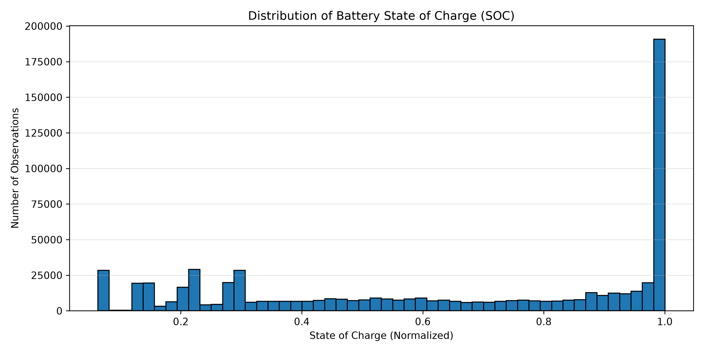
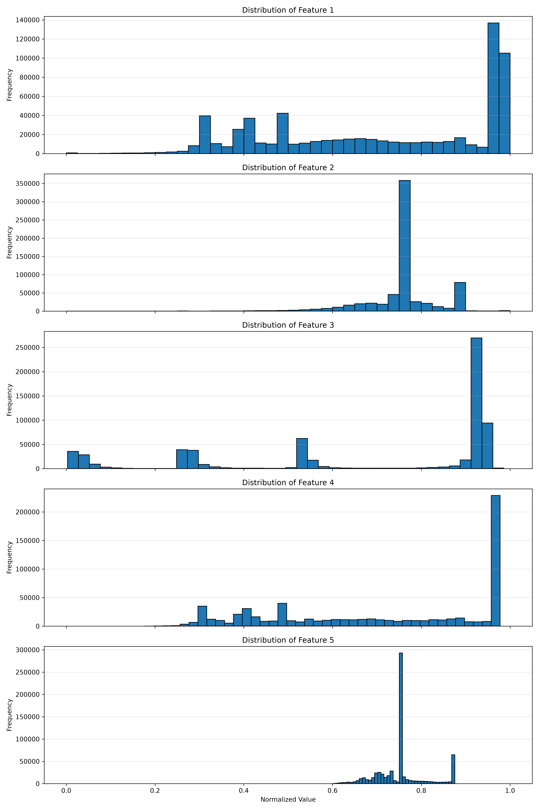
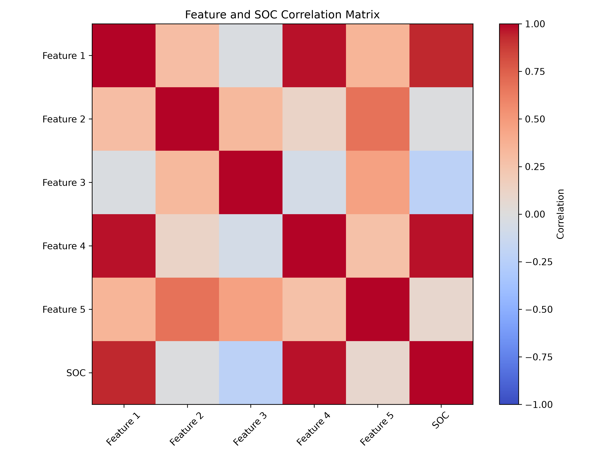
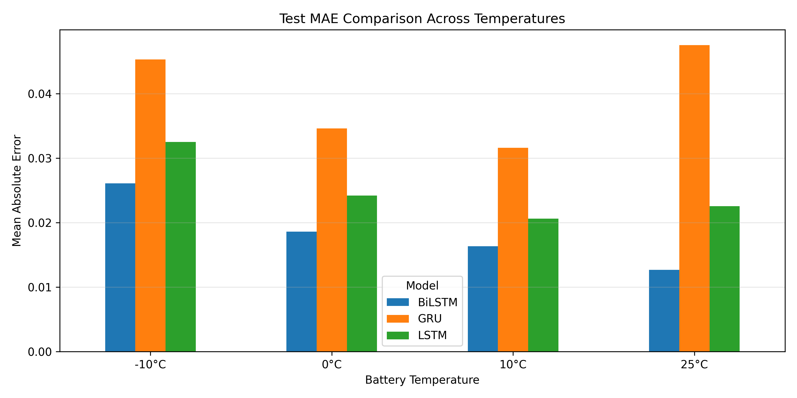
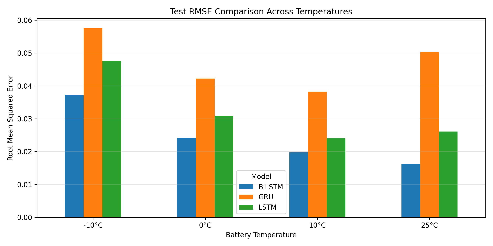
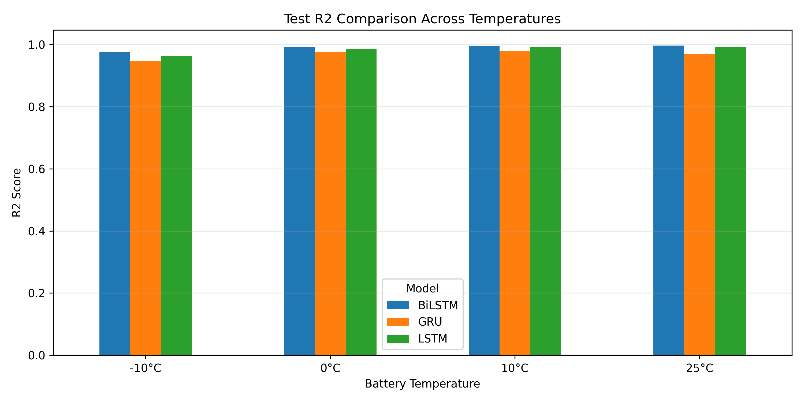
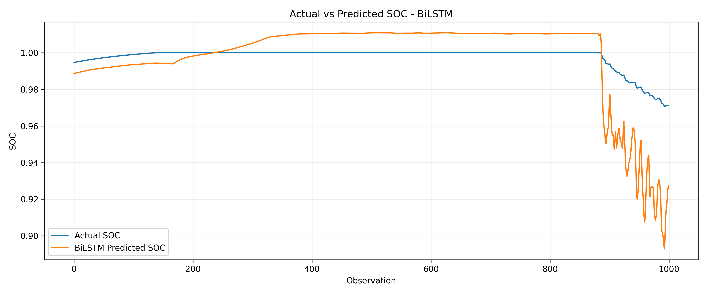

# 🔋 EV Battery Intelligence System
### AI-Powered Lithium-Ion Battery State of Charge (SOC) Estimation

An experimental deep-learning system for estimating the State of Charge (SOC) of lithium-ion batteries using and comparing three recurrent neural network architectures: **LSTM, GRU and BiLSTM**.

<p align="center">
  <a href="https://ev-battery-intelligence-d6sgupkdzs7u2bxd3tmprt.streamlit.app/">
    <strong>🚀 Live Application</strong>
  </a>
  &nbsp; | &nbsp;
  <a href="https://github.com/khushbushelake/EV-Battery-Intelligence">
    <strong>💻 GitHub Repository</strong>
  </a>
</p>

---

## 📌 Project Overview

Battery State of Charge (SOC) estimation is an important component of battery management systems. Accurate SOC estimation helps understand the remaining charge available in a lithium-ion battery.

This project develops and evaluates deep-learning models to estimate battery SOC from five prepared input features using sequential battery data.

The system includes:
- Battery dataset exploration and preprocessing.
- LSTM, GRU and BiLSTM model development.
- Model training and validation.
- Independent testing under four temperature conditions.
- SOC prediction analysis and visualization.
- Interactive Streamlit dashboard.
- Automated technical PDF report generation.

## 🎯 Objectives

1. Explore and preprocess lithium-ion battery data.
2. Develop three recurrent deep-learning architectures.
3. Compare model performance using MAE, RMSE and R².
4. Evaluate generalization across different temperature conditions.
5. Visualize actual and predicted SOC values.
6. Present results through an interactive dashboard.

## 📂 Dataset

**Dataset:** LG 18650HG2 Lithium-Ion Battery Dataset

The project uses prepared battery data containing five input features and SOC as the prediction target.

| Parameter | Description |
|---|---|
| Battery type | LG 18650HG2 |
| Input features | 5 prepared features |
| Target | State of Charge (SOC) |
| Training observations | 669,956 |
| Sequence length | 30 time steps |
| Sequence stride | 5 |
| Independent test conditions | -10°C, 0°C, 10°C and 25°C |
| Independent test predictions | 34,703 |

The original dataset and intermediate processed files are excluded from this repository to keep it lightweight.

## 🧠 Deep Learning Models

Three recurrent neural network architectures were trained and compared.

| Model | Architecture |
|---|---|
| LSTM | Long Short-Term Memory |
| GRU | Gated Recurrent Unit |
| BiLSTM | Bidirectional Long Short-Term Memory |

### Independent Test Performance

BiLSTM achieved the strongest overall performance across the four temperature-specific test evaluations.

| Model | Average MAE | Average RMSE | Average R² |
|---|---:|---:|---:|
| **BiLSTM** | **0.01842** | **0.02435** | **0.99021** |
| LSTM | 0.02495 | 0.03214 | 0.98347 |
| GRU | 0.03976 | 0.04711 | 0.96782 |

*Note: These are unweighted averages of the four temperature-specific test metrics.*

### Test Evaluation by Temperature

| Temperature | BiLSTM MAE | BiLSTM RMSE | BiLSTM R² |
|---|---:|---:|---:|
| -10°C | 0.02607 | 0.03728 | 0.97725 |
| 0°C | 0.01858 | 0.02415 | 0.99188 |
| 10°C | 0.01635 | 0.01976 | 0.99481 |
| 25°C | 0.01267 | 0.01622 | 0.99688 |

## 📊 Project Visualizations

### Exploratory Data Analysis







### Model Evaluation







### SOC Prediction



## 🖥️ Interactive Dashboard

The Streamlit application provides the following sections:

- **Project Overview:** Project summary and key statistics.
- **Battery Data Analysis:** Dataset exploration and visualizations.
- **Model Comparison:** Comparison of LSTM, GRU and BiLSTM.
- **Independent Test Evaluation:** Performance across four temperatures.
- **SOC Prediction:** Exploration of saved BiLSTM predictions, actual SOC and prediction errors.
- **Model Architecture:** Architecture and configuration details.
- **Technical Report:** Access to the generated PDF report.

### Live Demo

[Open EV Battery Intelligence System](https://ev-battery-intelligence-d6sgupkdzs7u2bxd3tmprt.streamlit.app/)

## 🛠️ Technology Stack

| Category | Technologies |
|---|---|
| Programming | Python |
| Data Processing | NumPy, Pandas, SciPy |
| Visualization | Matplotlib |
| Deep Learning | TensorFlow, Keras |
| Application | Streamlit |
| PDF Generation | ReportLab |
| Development | VS Code, Google Colab |
| Version Control | Git, GitHub |

## 📁 Repository Structure

```text
EV-Battery-Intelligence/
│
├── app/
│   └── app.py
│
├── models/
│   ├── lstm_battery_soc.keras
│   ├── gru_battery_soc.keras
│   └── bilstm_battery_soc.keras
│
├── notebooks/
│   └── 01_dataset_exploration.py
│
├── reports/
│   ├── EDA visualizations
│   ├── Model comparison charts
│   ├── Independent test results
│   ├── SOC prediction results
│   └── EV_Battery_Intelligence_Technical_Report_V3.pdf
│
├── src/
│   └── prepare_data.py
│
├── .gitignore
├── README.md
└── requirements.txt
```

## ⚙️ Installation and Local Setup

### 1. Clone the repository

```bash
git clone https://github.com/khushbushelake/EV-Battery-Intelligence.git
```

### 2. Navigate to the project directory

```bash
cd EV-Battery-Intelligence
```

### 3. Create a virtual environment

```bash
python -m venv .venv
```

Activate it on Windows:

```powershell
.venv\Scripts\activate
```

### 4. Install dependencies

```bash
pip install -r requirements.txt
```

### 5. Run the Streamlit application

```bash
python -m streamlit run app/app.py
```

Open the local URL displayed in your terminal.

## 📄 Technical Report

A detailed technical evaluation report is available in the `reports` directory.

**Report:** `EV_Battery_Intelligence_Technical_Report_V3.pdf`

It covers the system overview, dataset, preprocessing, model configurations, validation, independent testing, SOC prediction analysis, findings and limitations.

## ⚠️ Limitations and Scope

- The application analyzes saved experimental battery test data and predictions.
- It is not connected to a physical EV battery or a live Battery Management System (BMS).
- Independent testing covers four specified temperature conditions.
- The reported metrics are based on the prepared dataset and evaluation methodology used in this project.
- Real-world deployment would require additional validation with live battery measurements and hardware integration.

## 🔮 Future Enhancements

- Real-time battery data acquisition.
- Integration with a Battery Management System (BMS).
- Live SOC estimation through model inference.
- Battery State of Health (SOH) estimation.
- Battery degradation and remaining useful life prediction.
- Evaluation across additional battery chemistries and operating conditions.

## 👩‍💻 Developer

**Khushbu Uttam Shelake**

B.Tech – Computer Science and Engineering